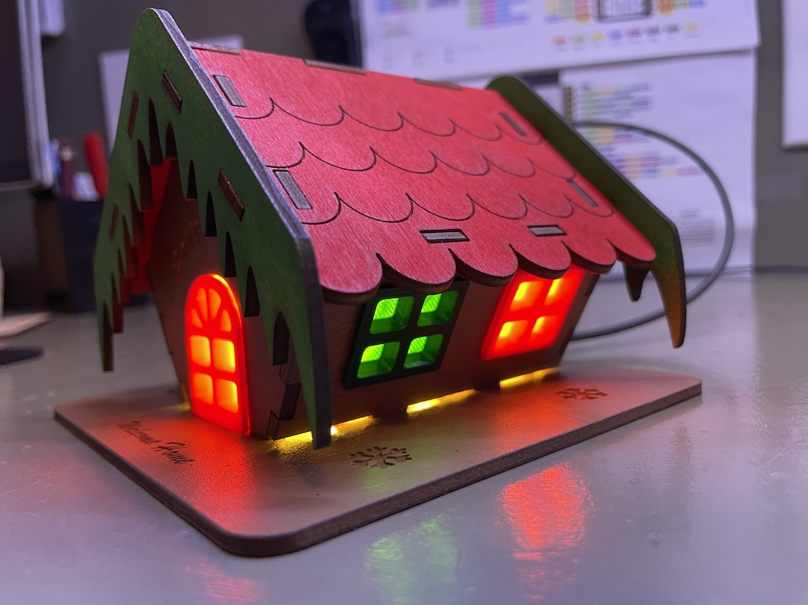
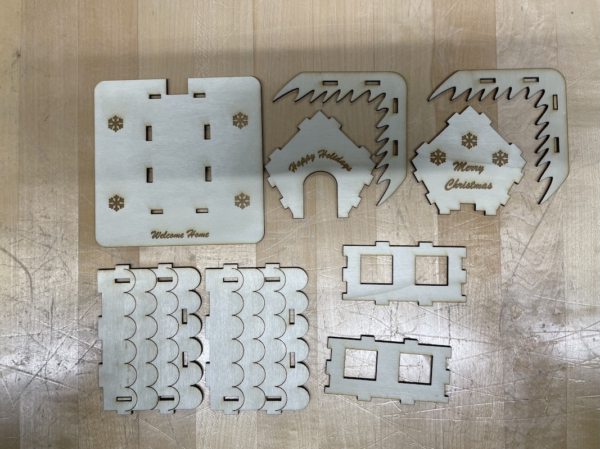
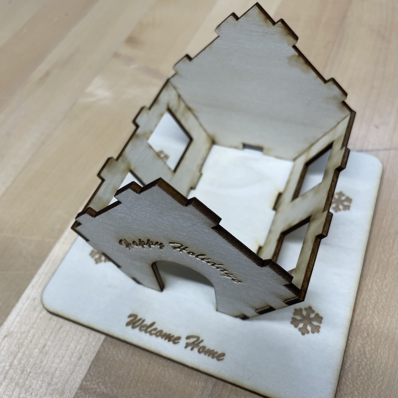
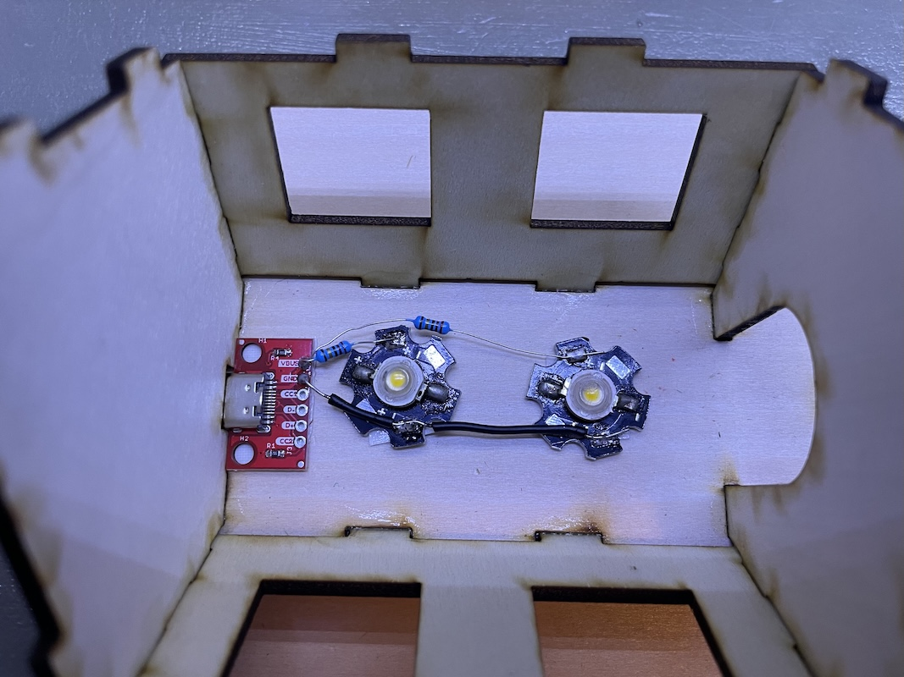
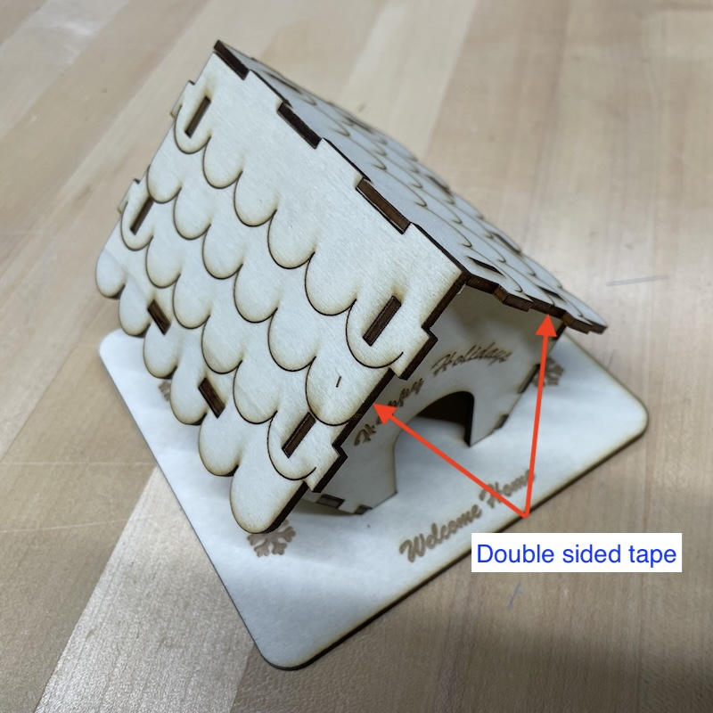
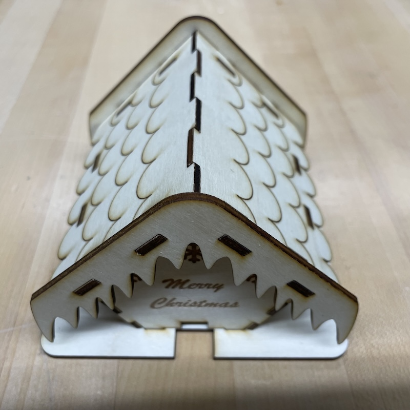

# Gingerbread House

## Tools and Materials

### Tools
* 3d printer
* Laser cutter
* Soldering iron

### Materials
* Red and green filament (door and windows)
* 1/8" basswoord boards [Amazon](https://www.amazon.com/dp/B0D91F14Y2)
* COB LED light [AliExpress](https://www.aliexpress.us/item/3256807134620275.html) | [Amazon](https://www.amazon.com/dp/B07DHB13J4)
* USB-C breakout board [AliExpress](https://www.aliexpress.us/item/3256809276708466.html) | [Amazon](https://www.amazon.com/dp/B0F2S1K5X8)
* 22 Ohm resistor x 2
* USB-C cable
* PVA glue (aka school glue or book binding glue). Alternatives: hot glue, super glue, wood glue, B7000, etc. Anything that works for paper will work for wood (what is paper but wood?). It does not need to be very strong.
* Double sided tape.

If you want to give your gingerbread house some colors:

* Red, green, nutmeg spray paints. Alternatives: permanent markers, dry erase markers, craft pens, etc. Anything that can color unfinished wood will work.

## Laser engraving, marking, and cutting

I am using three colors in the SVGs and mapping them into cutting, marking, and engraving. The cutter I am using is a *60 Watt Epilog Mini* with a 600x300 mm bed. In the first version, the engraved graphics didn't stand out very well on the nutmeg colored paint. So, I duplicated the engrave graphics, remove the fill, and marked the outline. It worked very well. The marking should be done *after* the engraving.

I've put all pieces in the [template](template.svg). Since I was making quite a few of them, I spray painted the plywood before engraving and cutting. Engraving is in fact better after painting anyway. Then I sorted the pieces based on the colors and created an svg file for each color containing multiple copies of the pieces. I used red for the roof, green for the eaves, and nutmeg for everything else.

| Color | Action | Power | Speed | Note |
| ----- | ------ | ----- | ----- | ----- |
| ${\color{green}\textsf{Green}}$ | Engrave | 100 | 100 |
| ${\color{blue}\textsf{Blue}}$ | Mark | 20 | 100 | engrave outlines
| ${\color{blue}\textsf{Blue}}$ | Mark | 35 | 100 | shingles
| ${\color{red}\textsf{Red}}$ | Mark | 100 | 45 |

## 3D printing

The STLs for the door and windows can be found in this directory. I am using a *Flashforge Adventure 3 Lite* printer. I am printing two red windows and two green ones. The models were created with Autodesk Fusion (free for personal use). In the slicer (FlashPrint 5), I sliced the models with no raft and linear supports. The flanges of the door and window are overhanging. Although just a little bit, they don't work well without supports. 

You may need to adjust your slicer settings depending on your printer, filament, and slicer. If you need to make adjustments to the models themselves, you can download the Fusion file in this folder and edit it in Autocad Fusion.

## Lights

I am using two LEDs in paralell. They are rated 3V 1W. With a 22 Ohm resistor in series, I am getting just about 3V on the LED. I am only measuring 90 mA. That's only 0.27W. But two are bright enough for this project.

The whole circuitry is soldered onto the USB-C breakout board. The board has two 5.1k resistors for triggering USB PD at 5V. So this works with "smart" chargers too. If you don't need to worry about smart chargers, there are cheaper breakout boards available.

## Assembly

All parts snap fit together. However, since plywood is not nearly as plastic as, well, plastic, I cut the wooden pieces with slightly more tolerance than I would plastic. As a result, the wooden pieces fit snuggly, but not too tight, otherwise the risk of breaking or splitting is high. So I rely on a smudge of PVA glue to hold the body of the house to the base. Even so, be very gentle when trying to snap pieces together. Don't try to force anything.

Step 1: snap the 4 walls together, then carefully insert them into the base. Avoid using too much force. If the fitting is too tight, use a file or sandpaper to file off a little wood around the slots.  Once it's snug and secure, apply a little glue to the seams. Leave it to cure. The duration depends on your glue. If you are impatient, use super glue or hot glue. But I prefer slow curing glue so that I can make small adjustments while it's curing. I also prefer glue with a little flexibility, such as PVA glue.

Step 2: use double sided tapes to fasten the circuitry to the base, aligning the USB port to the opening in the back. The lights just need a little bit of tape since they don't bear any force. The USB-C breakout board needs to sustain the force of plugging and unplugging the cable, so it needs to be securely fastened. Use a few drops of hot glue or super glue if desired.

Step 3: carefully snap both pieces of the roof to the walls. It requires a little dexterity and patience. I reccommend starting from the two tabs connecting the roof to the wall, and working your way up to the top of the A-frame. But don't close the pinnacle until you have both pieces in place. 

My experience is that you don't need glue for the roof. The number of tabs and their opposing angles are enough to keep it pretty secure. I also prefer not using glue so that I can open it up if needed.

Step 4: if your doors and windows fit snuglly without needing glue but don't need too much force to press into the frames, you can install them now. If they are rather finicky to be installed, you might want to do this step earlier. If they are too loose, use a little glue on the inside.

Step 5: Insert the eaves onto the roof pieces. If they are too loose, cut a few very thin (~2.5mm) strips of double sided tape, put them on the sides of the roofs to help secure the eaves. Again, I prefer not using glue here.

